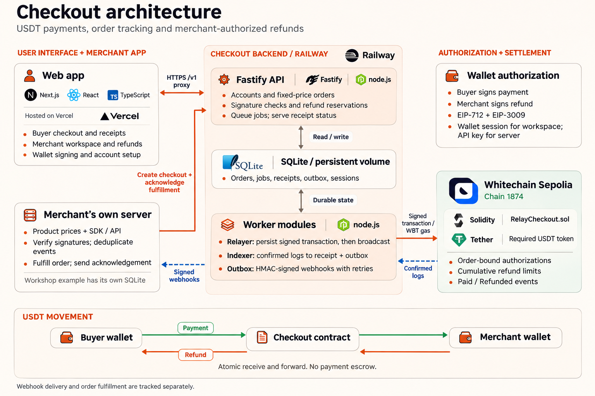

<p align="center"></p>
<h1 align="center">Checkout</h1>
<p align="center">USDT checkout and payment management.</p>
<p align="center"><a href="https://checkout.allensaji.dev">Live app</a> | <a href="https://checkout.allensaji.dev/docs">Developer docs</a> | <a href="docs/getting-started.md">Get started</a> | <a href="docs/integration.md">Integration</a> | <a href="docs/architecture.md">Architecture</a> | <a href="CONTRIBUTING.md">Contribute</a></p>

Checkout connects a USDT payment to the order behind it. Customers authorize a payment, the relayer covers gas, and merchants receive funds directly. Confirmed payments create durable receipts and signed notifications; merchants can retry delivery and authorize partial refunds from their workspace.

## What is included

- Wallet checkout with payment status, fulfillment status and printable receipts.
- Merchant workspace with wallet sign-in, order history, notification retries and refunds.
- Server SDK for checkout creation, fulfillment acknowledgement and refund submission.
- Persist-before-broadcast relayer, confirmed-event indexer and retrying webhook outbox.
- Solidity payment router with order-bound authorizations and cumulative refund limits.
- In-app developer documentation with copyable examples at `/docs`.

## Architecture



The API and worker modules share a Node.js runtime and SQLite database. The merchant application handles fulfillment separately. See the [architecture guide](docs/architecture.md) for payment state, authorization and recovery details.

## Stack

Next.js App Router, React and TypeScript for the frontend. Fastify, viem and SQLite for the API and worker. Solidity for payment accounting.

## Integrate with the hosted service

[Create a merchant account](https://checkout.allensaji.dev/register), save your server credentials, and connect a signed webhook receiver. Follow the [quickstart](https://checkout.allensaji.dev/docs/quickstart) to create a payment link through the hosted API without installing an SDK.

## Run locally

Requires Node 22.13+ in the 22.x line or Node 24+, and pnpm 10.8.1.

```sh
pnpm install --frozen-lockfile
pnpm check
pnpm dev:web
```

Open `http://127.0.0.1:4210`. The landing page and documentation work without the API. Checkout and the workspace require the API, worker and configured merchant service; follow the [setup guide](docs/getting-started.md). API credentials and relay keys stay server-side.

| Route                | Purpose                                 |
| -------------------- | --------------------------------------- |
| `/`                  | Product overview                        |
| `/register`          | Wallet-signed merchant account creation |
| `/merchant/settings` | Profile, credentials and webhook checks |
| `/merchant`          | Merchant sign-in and workspace          |
| `/start`             | Integration setup overview              |
| `/docs`              | Developer guides and API reference      |
| `/shop`              | Example merchant checkout               |
| `/checkout/:id`      | Buyer authorization and receipt         |

## Integration

The server SDK includes TypeScript declarations and can be installed as a local tarball. It has not been published to the npm registry. Run `npm pack ./sdk`, then install the resulting archive in your server app. Import `checkoutClient` from `@whitechain-checkout/server` after installation, or use the repository-relative import below. Coding agents can follow the [integration skill](sdk/skills/integrate-checkout/SKILL.md); the hosted [OpenAPI reference](https://checkout.allensaji.dev/openapi.json) and [plain-text docs](https://checkout.allensaji.dev/llms-full.txt) describe the API.

```js
import { checkoutClient } from './sdk/server.mjs';

const checkout = checkoutClient({
  baseUrl: process.env.CHECKOUT_API,
  apiKey: process.env.CHECKOUT_API_KEY,
});

const order = await checkout.create({
  orderId: 'booking-1042',
  title: 'Studio workshop',
  amount: '2000000', // 2 USDT
});
// Redirect the customer to order.checkoutUrl.
```

Set `CHECKOUT_BASE_URL` on the API to enable checkout URLs. Verify webhook signatures, persist fulfillment idempotently, then acknowledge completion. See the [integration guide](docs/integration.md) and [complete booking example](examples/booking/server.mjs).

## Repository structure

| Directory                 | Responsibility                                      |
| ------------------------- | --------------------------------------------------- |
| `contracts/`              | Payment and refund accounting                       |
| `src/api/`                | Checkout, merchant and session endpoints            |
| `src/workers/`            | Relayer, indexing and notification delivery         |
| `src/storage/migrations/` | Versioned SQLite schema                             |
| `sdk/`                    | Server integration client and webhook verifier      |
| `web/`                    | Landing, product application and documentation      |
| `examples/booking/`       | Independent merchant integration                    |
| `tests/`                  | API, persistence, cryptographic and fork checks     |
| `deployments/`            | Deployment manifests and public settlement evidence |

## Verification

`pnpm check` runs formatting, lint, strict frontend type checking, Solidity compilation, offline tests and the Next.js production build. `pnpm test:fork` runs the full suite against an isolated Anvil fork, including process recovery, merchant isolation, wallet sessions, notification replay and partial refunds. See [operations](docs/operations.md) for fork setup. CI runs on pull requests and manual dispatch.

The recorded deployment is Whitechain Sepolia, chain 1874, using USDT at `0xcedfB56113143d55b2358b8CFbB0dEB5Ad2f55a7`. Public evidence includes a [2 USDT payment and 0.5 USDT refund](deployments/whitechain-sepolia/smoke-result.json), plus a [MetaMask checkout and partial refund](deployments/whitechain-sepolia/browser-checkout-result.json). A separate [hosted payment and wallet-signed browser refund](deployments/whitechain-sepolia/hosted-checkout-result.json) verified the deployed merchant integration and fulfillment.

## Settlement evidence

- [Verified checkout contract](https://explorer.testnet.whitechain.io/address/0x43fbe3884038e34e811cf251ae00dfd5df826034?tab=contract)
- [Hosted 0.10 USDT payment](https://explorer.testnet.whitechain.io/tx/0x7dcd8f77bfa66dc13ffcf6c537bc044f5666b8980cc0b4c37dd4f46df9cda49a)
- [Merchant-authorized 0.05 USDT refund](https://explorer.testnet.whitechain.io/tx/0x33f2589ad108f0365fcdb52dfc8e95b3babd837abe599cd5a61fc4b7601fbb85)
- [Customer receipt](https://checkout.allensaji.dev/checkout/78a479c2-a147-46ef-bdfb-367680eb1aaa)
- [Whitechain integration feedback](WHITECHAIN_FEEDBACK.md)

Whitechain USDT settlement lets an existing token holder pay a merchant wallet directly, with order-bound payment and refund accounting independently inspectable onchain. EIP-3009 authorizations let our relayer pay WBT gas without taking custody of the customer's funds. A conventional card rail can support checkout and refunds, but does not settle this USDT into the merchant's Whitechain wallet or expose the same contract-enforced receipt for other onchain software to inspect. The integration currently targets Whitechain Sepolia; it does not claim these primitives are exclusive to Whitechain.

## Deployment and security

This deployment uses test assets. The frontend, API and independent example merchant are publicly hosted. Mainnet deployment and independent security review are not complete. The relayer can be paused by the operator; check `/v1/config` for current availability. The deployed contract has [exact-match source verification](https://explorer.testnet.whitechain.io/address/0x43fbe3884038e34e811cf251ae00dfd5df826034?tab=contract). The current system uses single-host SQLite; automatic reorg rollback and transaction fee replacement are not implemented.

Payment goes directly to the merchant. Refunds require the merchant's authorization and available funds; Checkout does not provide escrow or guarantee refunds. Browser authentication supports EOA wallets. Wallet-signed registration is available when enabled by the operator. New accounts must configure and check their webhook before creating checkouts.

Read [architecture](docs/architecture.md), [operations](docs/operations.md) and [security policy](SECURITY.md) before running the service. Contributions are covered in [CONTRIBUTING.md](CONTRIBUTING.md). A project-wide software license has not yet been selected; public source availability does not grant an open-source license. Bundled fonts retain their own license files.
